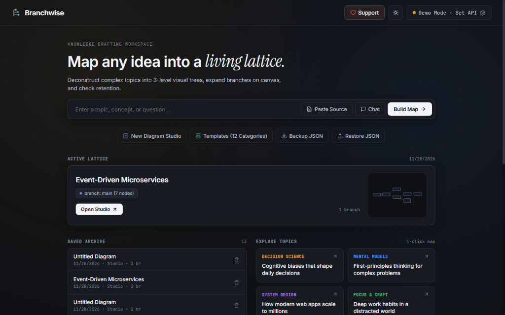
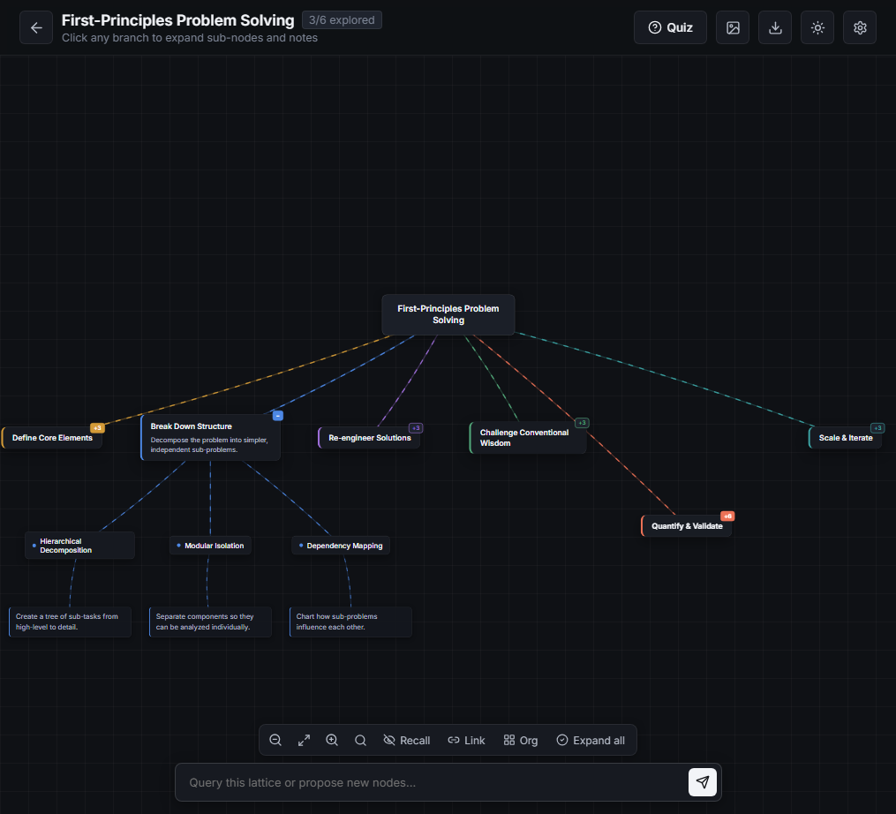
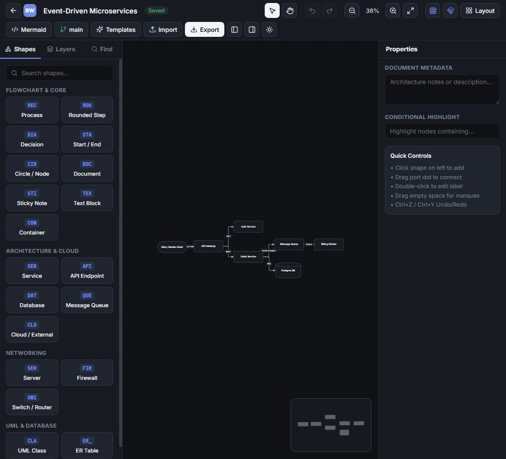
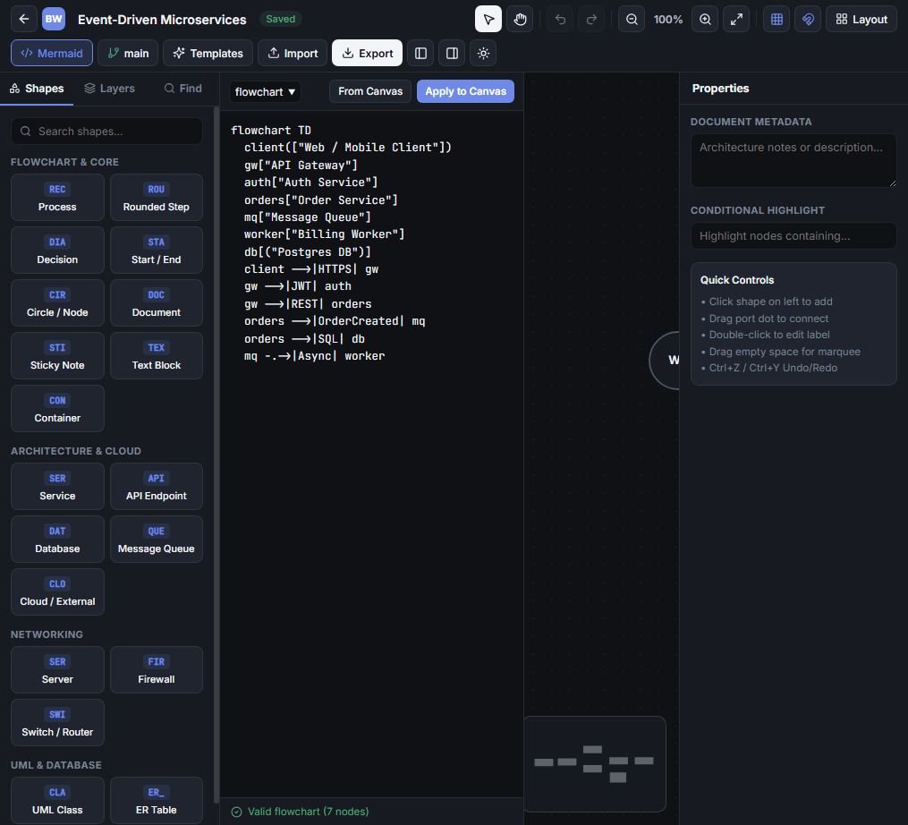
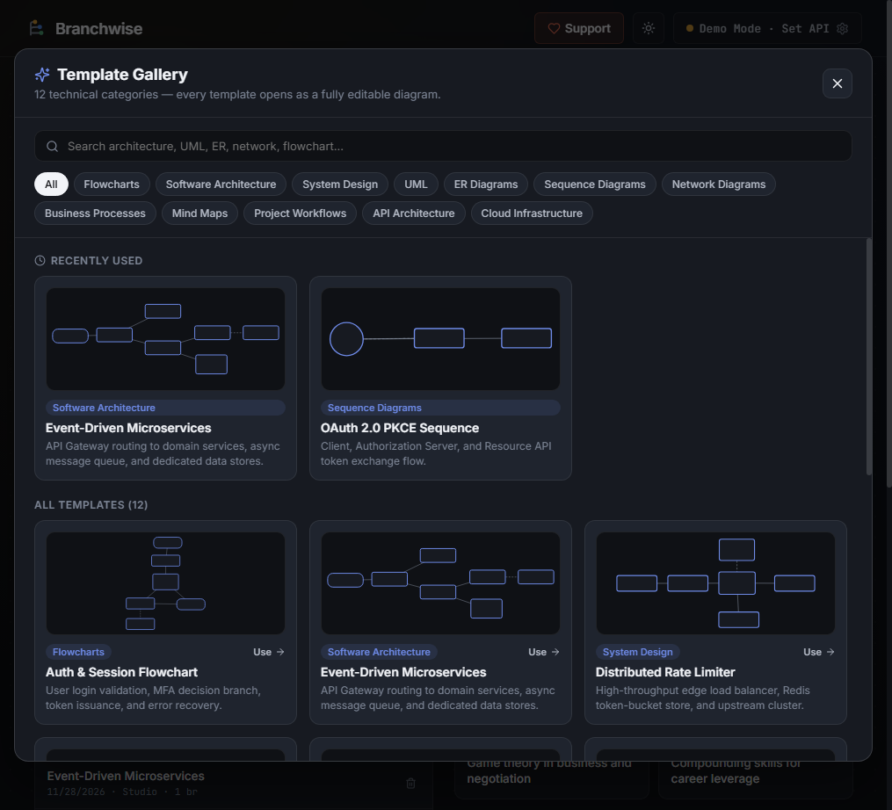
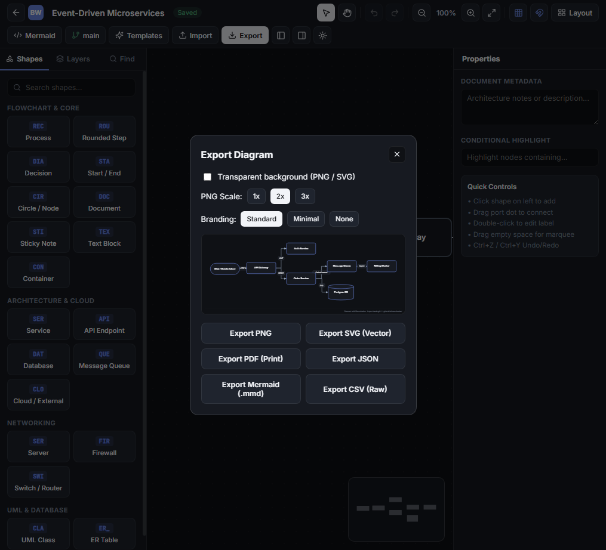
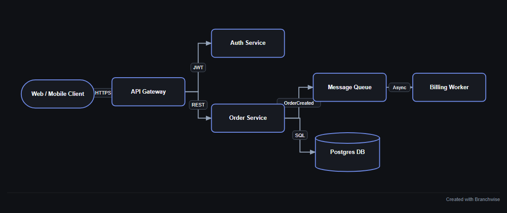
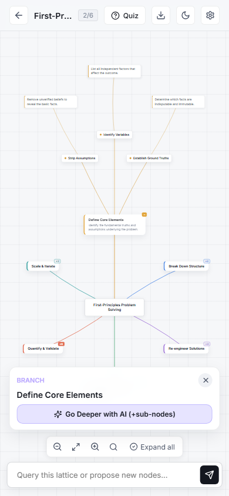
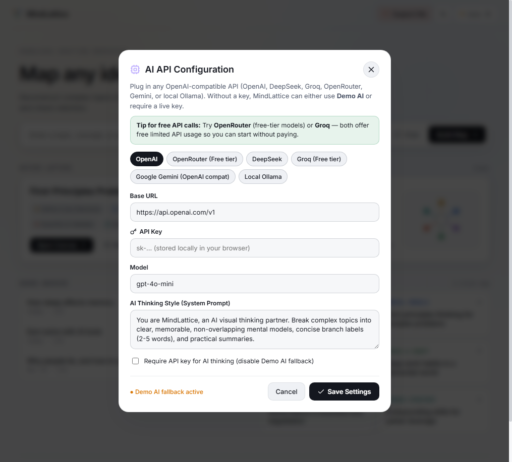

# Branchwise

A local-first, developer-focused **diagramming workspace** combining visual editing, Mermaid diagram-as-code, local version branching, and an integrated **AI mind-mapping module** (BYOK).

Made freely for everyone by **[Sewak Singh](https://github.com/mrsingh111)** · **[Try Live App →](https://mrsingh111.github.io/branchwise/)**

[](https://buymeacoffee.com/sewak_singh)
[](LICENSE)

---

## Features

### Pro Diagram Studio
- **Infinite Pan & Zoom Canvas:** Smooth pan (`Space + Drag` or Pan tool), wheel zoom, Zoom to Fit, Zoom to Selection, toggleable grid, snap-to-grid, smart alignment guide lines, and an interactive bottom-right minimap.
- **Technical Shape Libraries:** Flowchart (`Process`, `Rounded Step`, `Decision`, `Start / End`, `Circle`, `Document`, `Sticky Note`, `Text Block`, `Container`), Architecture & Cloud (`Service`, `API Endpoint`, `Database`, `Message Queue`, `Cloud`), Networking (`Server`, `Firewall`, `Switch / Router`), and UML/DB (`UML Class`, `ER Table`).
- **Flexible Connectors:** Drag from any shape's 4 connection ports, edit labels inline or in the inspector, switch routing (`Orthogonal`, `Straight`, `Curved`), line styles (`Solid`, `Dashed`, `Thick`), arrowheads, and reassign Source/Target endpoints.
- **Productivity & Precision:** Marquee selection, `Shift+Click` multi-select, single/multi-object resize, Group/Ungroup (`Ctrl+G` / `Ctrl+Shift+G`), Duplicate (`Ctrl+D`), Copy/Paste (`Ctrl+C` / `Ctrl+V`), Undo/Redo (`Ctrl+Z` / `Ctrl+Y`), Lock/Unlock, Layer visibility & lock controls, Align & Distribute tools, Find & Replace labels, Structural Validation, and Hierarchical/Grid auto-layout.
- **12-Category Template Gallery:** Editable built-in templates across Flowcharts, Software Architecture, System Design, UML, ER Diagrams, Sequence Diagrams, Network Diagrams, Business Processes, Mind Maps, Project Workflows, API Architecture, and Cloud Infrastructure, with category filtering, search, SVG previews, and recently used tracking.
- **Local Branching & Version History:** Create independent local branches (`main`, `feature-v2`, etc.), switch/rename branches, save named snapshots + periodic auto-snapshots, restore prior snapshots (with safety autosave), and compare two snapshots side-by-side (added/removed/modified nodes and connectors).

### Integrated AI Mind-Mapping Module (BYOK)
- **3-Level Interactive Knowledge Maps:** Radial, Tree, and Org layouts with automatic overlap resolution, inline editing, Recall blur mode, Mastery tracking, Cross-Node Synthesis, Map-Aware Q&A, Retention Quizzes, and Reasoning Chat.
- **Bring Your Own Key (11 Providers + Demo Mode):** Supports OpenRouter, Groq, OpenAI, OpenCode Zen, DeepSeek, Together AI, Mistral, xAI Grok, Google Gemini, Ollama, and LM Studio, plus offline Demo mode.

---

## Screenshots

| Home Workspace & Active Lattice | 3-Level Mind Map (Dark Mode) |
| :---: | :---: |
|  |  |

| Pro Diagram Studio | Split-Screen Mermaid Editor |
| :---: | :---: |
|  |  |

| 12-Category Template Gallery | Export Modal & Branding Preview |
| :---: | :---: |
|  |  |

| Exported Diagram Sample (PNG/SVG) | Home Workspace |
| :---: | :---: |
|  |  |

| Mobile View (`390×844`) | AI API Configuration |
| :---: | :---: |
|  |  |

---

## Installation

```bash
git clone https://github.com/mrsingh111/branchwise.git
cd branchwise
npm install
npm run dev
```

Open `http://localhost:5173/` in your browser.

### Production Build, Testing & Deployment

```bash
npm test       # Run Vitest automated test suite
npm run build  # Build production bundle into dist/
npm run preview
```

To deploy `dist/` to GitHub Pages:

```bash
npm run build && npx gh-pages -d dist
```

---

## Supported Mermaid Syntax

Branchwise includes a split-screen Mermaid code editor (`Mermaid` toggle in Studio) with live line-numbered validation and `From Canvas` / `Apply to Canvas` sync for:

- **Flowcharts (`flowchart TD|LR|TB|RL|BT`, `graph`):** Nodes (`[]`, `()`, `([])`, `{}` , `[()]`, `(())`, `[/ /]`), edges (`-->`, `---`, `-.->`, `==>`, labeled edges `-- text -->` and `-->|text|`), and `subgraph ... end` containers.
- **Sequence Diagrams (`sequenceDiagram`):** `participant` / `actor` declarations (with `as` aliases) and `->>`, `-->>`, `->`, `-->` messages.
- **Class Diagrams (`classDiagram`):** `class Name { ... }` member blocks, inline `Class : member` lines, and relationship connectors (`<|--`, `--|>`, `*--`, `o--`, `-->`, `..>`, `--`).
- **State Diagrams (`stateDiagram-v2` / `stateDiagram`):** `[*]` start/end states, `state "Label" as id` aliases, and `A --> B : event` transitions.
- **Entity Relationship Diagrams (`erDiagram`):** `ENTITY { ... }` column blocks and cardinality relationships (`||--o{`, etc.).
- **Mind Maps (`mindmap`):** Parsed on the Home page via **Paste Source** into 3-level knowledge maps.

Unsupported headers (e.g., `gantt`, `pie`) and unparsed directives (e.g., `classDef`, `style`, `click`, `linkStyle`) report explicit line-numbered errors or warnings rather than failing silently.

---

## Import & Export Formats

- **Import:** Mermaid (`.mmd`, `.mermaid`, `.txt`), CSV edge-lists/node-tables (`.csv`), Branchwise JSON (`.json`), and full workspace JSON backups (`Restore JSON`).
- **Export:**
  - **SVG:** True vector export preserving dimensions, shapes, colors, connectors, and labels.
  - **PNG:** Rasterized from vector SVG with configurable scale (`1x`, `2x`, `3x`) and optional transparent background.
  - **PDF:** Vector print-sheet export via browser print dialog.
  - **JSON & Mermaid (`.mmd`):** Document JSON, workspace backup JSON, and Mermaid source export.

---

## Data Storage & Privacy

- **100% Client-Side:** No backend server or account is required.
- **IndexedDB (`branchwise_db`) + `localStorage` Fallback:** Studio diagrams, branches, snapshots, and mind maps are persisted locally in IndexedDB with automatic migration from legacy `localStorage` data.
- **API Keys:** Optional BYOK AI credentials are stored solely in your browser's `localStorage` and sent only to the provider endpoint you configure.

---

## Current Limitations

- **Local-Only Branching:** Branches are independent local alternatives; collaborative Git-style 3-way conflict merging and cloud sync are not implemented.
- **Mermaid Subset:** Advanced Mermaid features (`gantt`, `pie`, `gitGraph`, custom `classDef` styling, nested subgraphs) are not rendered visually and surface validation errors/warnings instead.
- **PDF Export:** Uses the browser's print-to-PDF sheet (`window.print()`), which requires popups to be enabled.

---

## Roadmap

- Direct on-canvas draggable connector endpoint handles (in addition to inspector endpoint selectors)
- Multi-page / tabbed diagrams within a single document
- Additional Mermaid diagram types (`gitGraph`, `journey`) and `classDef` color mapping
- Optional PWA service worker for full offline installability

---

## Support

If Branchwise helps you design or learn faster, consider supporting the project:

👉 **[buymeacoffee.com/sewak_singh](https://buymeacoffee.com/sewak_singh)**

## License

[MIT](LICENSE) © 2026 Sewak Singh
